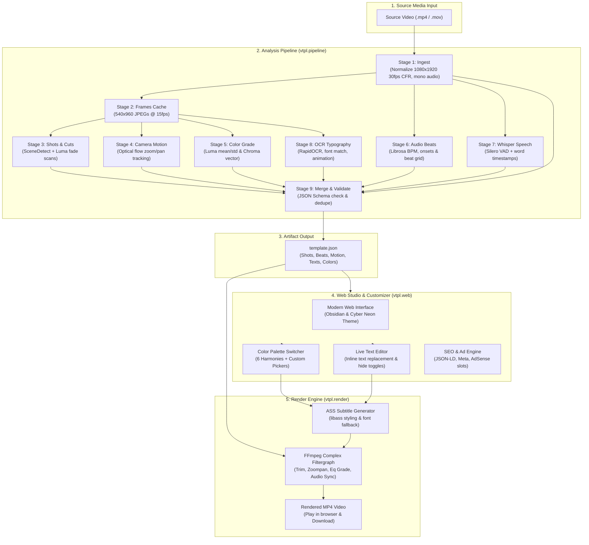
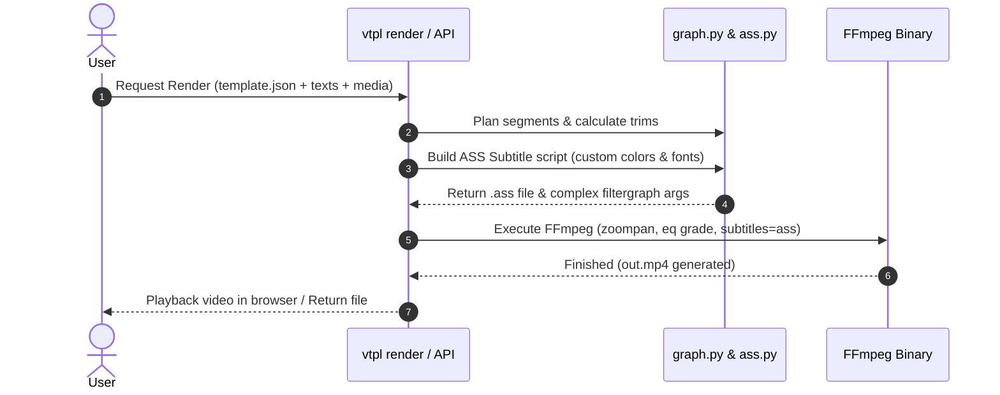

# Video Template Extractor (`vtpl`) — Architecture & Technical Guide

This document provides an end-to-end technical explanation and architectural diagrams of the **vtpl** (Video Template Extractor) system, covering both the core analytical pipeline and the web application.

---

## 1. System Overview & Architecture Diagram

`vtpl` turns a short-form vertical video (Reels / Shorts / TikTok) into a machine-readable `template.json`, allows interactive editing (text headlines, fonts, color palettes), and re-renders new videos with user-supplied clips and music while replicating the original pacing, camera movement, and aesthetic.

---

## 2. Pipeline Stages Deep-Dive

Each analysis stage is implemented as a pure, cached step in `vtpl/analyzers/` and managed by `vtpl/pipeline.py`. Outputs are saved in `work/<video_id>/` where `<video_id>` is the 12-character SHA-256 hash of the video.

### Stage 1: `ingest` (`vtpl/ingest.py`)
* **Purpose**: Guarantees predictable frame rates and dimensions for all downstream computer vision and audio models.
* **Operations**:
  * Probes video metadata via `ffprobe`.
  * Normalizes to constant frame rate (CFR) `30 fps`, `1080x1920` vertical resolution (letterboxed/padded if source is 16:9).
  * Detects letterbox bounds (`content: {x, y, w, h}`) so letterbox black bars do not distort color grading.
  * Extracts audio as uncompressed mono WAV (`audio.wav`, 22.05 kHz).
* **Outputs**: `norm.mp4`, `audio.wav`, `meta.json`.

### Stage 2: `frames` (`vtpl/frames.py`)
* **Purpose**: High-speed image cache so subsequent detectors do not invoke FFmpeg frame-by-frame.
* **Operations**:
  * Extracts every second frame ($15\text{ fps}$) downscaled to $540\times 960$ JPEG images.
* **Outputs**: `frames/00000.jpg ...`, `frames.json`.

### Stage 3: `shots` (`vtpl/analyzers/shots.py`)
* **Purpose**: Identifies scene cut boundaries and transitions.
* **Operations**:
  * Runs PySceneDetect `AdaptiveDetector` on the frame sequence.
  * Scans frame average luma values to catch low-contrast dissolves and fades to black missed by content detectors.
  * Classifies boundaries into: `cut`, `fade`, `dissolve`, or `flash`.
* **Outputs**: `shots.json`.

### Stage 4: `motion` (`vtpl/analyzers/motion.py`)
* **Purpose**: Measures camera movement during each shot.
* **Operations**:
  * Uses Lucas-Kanade sparse optical flow tracking `cv2.goodFeaturesToTrack` on corner points across consecutive frames.
  * Distinguishes handheld camera shake (high frequency noise) from deliberate camera moves:
    * `zoom_in`: scale increases $> 1.0$ (up to $1.5\times$).
    * `zoom_out`: scale decreases $< 1.0$.
    * `pan`: significant horizontal or vertical drift ($dx, dy$).
    * `static`: stationary camera.
* **Outputs**: `motion.json`.

### Stage 5: `grade` (`vtpl/analyzers/grade.py`)
* **Purpose**: Quantifies the color and lighting profile of each shot.
* **Operations**:
  * Calculates luma distribution (`luma_mean`, `luma_std`) in the YUV color space.
  * Measures chroma saturation vector (`chroma`) across the picture area.
  * Renderer uses these statistics to apply matching brightness, contrast, and saturation to new user clips.
* **Outputs**: `grade.json`.

### Stage 6: `audio` (`vtpl/analyzers/audio.py`)
* **Purpose**: Reverse-engineers musical tempo, beat grid, and rhythm.
* **Operations**:
  * Uses `librosa` harmonic-percussive source separation.
  * Computes onset strength envelope and dynamic beat tracker to estimate `bpm` (Beats Per Minute).
  * Marks `beats_ms` and estimates downbeat bars (`downbeat_hint_ms`).
  * Computes `beat_pattern` (how many beats each video shot spans), enabling `--snap-to-beats` retiming.
* **Outputs**: `audio.json`.

### Stage 7: `speech` (`vtpl/analyzers/speech.py`)
* **Purpose**: Transcribes dialogue with exact word-level timestamps.
* **Operations**:
  * Runs `faster-whisper` with Silero VAD (Voice Activity Detection) filter.
  * Extracts `{w: "word", start_ms: 120, end_ms: 450, p: 0.95}`.
* **Outputs**: `speech.json`.

### Stage 8: `text` (`vtpl/analyzers/text/`)
* **Purpose**: Detects, tracks, and measures on-screen typography.
* **Sub-modules**:
  * `detect.py`: Runs RapidOCR on sample frames; re-reads small text at full $1080\times 1920$ resolution.
  * `track.py`: Groups OCR bounding boxes across time into continuous text tracks with spatial overlap.
  * `font.py`: Matches detected character shapes against the bundled catalog of OFL Google Fonts (`vtpl/assets/fonts/`).
  * `style.py`: Measures font size in pixels, hex color codes (`#FFFFFF`), stroke border width, and drop shadows.
  * `anim.py`: Measures entry/exit animation styles (`fade`, `pop`, `slide`, `none`) and transition duration in milliseconds.
* **Outputs**: `text.json`.

### Stage 9: `merge` (`vtpl/merge.py`)
* **Purpose**: Validates all stage outputs and produces the final unified JSON.
* **Operations**:
  * Deduplicates spoken captions vs text overlay graphics (prevents double-rendering).
  * Assigns slot placeholders (`clip_1 ... clip_N`, `text_1 ... text_N`).
  * Validates structure against strict JSON Schema in `vtpl/schema.py`.
* **Outputs**: `template.json`.

---

## 3. Render Engine Architecture (`vtpl/render/`)

* **`ass.py`**: Compiles typography into Advanced SubStation Alpha format with style headers, karaoke tags, and precise frame timings.
* **`graph.py`**: Constructs the dynamic FFmpeg `-filter_complex` string:
  * `[0:v]trim=start=X:end=Y,setpts=PTS-STARTPTS,scale=1080:1920:force_original_aspect_ratio=increase,crop=1080:1920[v0]`
  * `[v0]zoompan=z='...':x='...':y='...':d=...:s=1080x1920[v0z]`
  * `[v0z]eq=contrast=C:brightness=B:saturation=S[v0g]`
  * `[v0g]subtitles=temp.ass:fontsdir=...[vout]`

---

## 4. Web Application & Studio Architecture (`vtpl/web/`)

* **Framework**: FastAPI (async event loop with multi-worker ThreadPoolExecutor for video processing).
* **Live SSE Updates**: Endpoint `GET /api/jobs/{job_id}/events` streams Server-Sent Events updating all 9 pipeline steps in real time.
* **Color Palette Engine**: Client-side palette generator applying harmonious themes (Cyber Neon, Luxury Gold, Sunset Flame, Emerald Jade, Cosmic Violet, Ice Silver) with real-time JSON and YAML sync.
* **In-Browser Video Renderer**: `POST /api/render` synthesizes modified text and colors against normalized background footage in ~15s, serving back an HTML5 playable MP4 stream.
* **SEO & Crawlers**:
  * `GET /robots.txt` & `GET /sitemap.xml`.
  * JSON-LD Structured Data: `SoftwareApplication`, `HowTo`, `FAQPage`.
* **Ad Monetization**: Configurable Google AdSense slots (Leaderboard 728x90 and in-content native banner).

---

## 5. Git Branch Audit & Merging Status

| Branch | Merge Status | Details / Recommended Action |
|---|---|---|
| `main` | **Active Trunk** | Contains the full 9-stage analysis pipeline, web studio, color palette customizer, 1-click MP4 renderer, and CI/CD. |
| `origin/viral/feature/vtpl-core-pipeline` | **Merged** | Merged into `main`. Core pipeline foundation. |
| `origin/viral/feature/vtpl-text-overlays` | **Merged** | Merged into `main` via PR #2. OCR and text tracking. |
| `origin/viral/feature/vtpl-motion-grade-eval` | **Fully Incorporated** | Code diff against `main` is **0 bytes** (merged via PR #3 `341fcac`). The remote branch is safe to delete. |
| `origin/viral/feature/vtpl-web` | **Unmerged (Superseded)** | Early web branch from Nov 6. Our updated `main` branch already includes everything from this branch plus the new Cyber-Neon UI, Color Palette Presets, in-browser MP4 rendering, and full SEO/AdSense integrations. |
